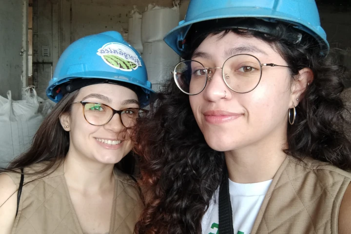

Dois membros do grupo CONEA, apresentarem seus trabalhos no evento SEI-SICITE que ocorreu do dia 29/10 a 01/11 na Universidade Tecnologia Federal do Paraná, Campus Francisco Beltrão.

Ana Beatriz Castro, apresentou o trabalho [“Ações extensionistas em conservação da natureza e Educação Ambiental: Projeto Biodiversidade na Escola”](https://www.even3.com.br/anais/seisicite2024/966825-acoes-extensionistas-em-conservacao-da-natureza-e-educacao-ambiental--projeto-biodiversidade-na-escola) no Seminário de Extensão e Inovação da UTFPR (SEI), enquanto Giuliane Stauski Florencio, apresentou seu trabalho de Iniciação Científica: [“Ecotoxicológica - aprendendo ecotoxicologia e explorando a biodiversidade dos Campos Gerais do Paraná”](https://www.even3.com.br/anais/seisicite2024/965109-ecotoxicologica--aprendendo-ecotoxicologia-e-explorando-a-biodiversidade-dos-campos-gerais-do-parana) , no Seminário de Iniciação Científica e Tecnológica da UTFPR (SICITE).

No dia 30 de outubro de 2024, os membros participaram da visita técnica à [Biorgânica](https://www.biorganica.com.br/institucional.aspx). A empresa possui sede no município de Realeza, sudoeste do estado do Paraná. De acordo com seu site oficial, buscam “levar os conceitos alternativos de agricultura sustentável a um outro nível, conectando produtores, processadores e clientes, estimulando o consumo consciente e contribuindo para o desenvolvimento do setor”.

Acompanhe mais novidades em nosso Instagram [@conea.utfprpg](https://www.instagram.com/conea.utfprpg/)
