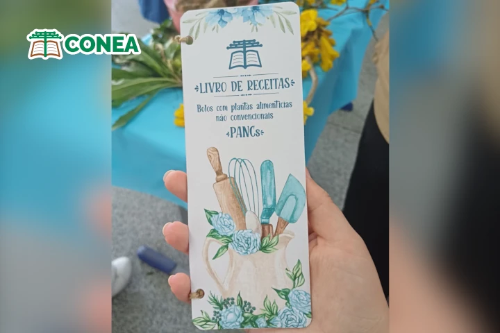
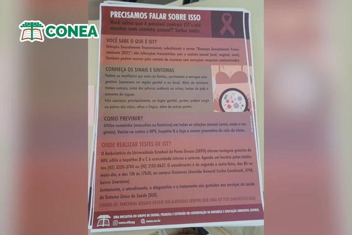

O grupo CONEA participou do "PRINCESA EM FESTA" evento de caráter sócio-recreativo-cultural promovido pela Secretaria Municipal de Cultura de Ponta Grossa, município do Paraná. Foram realizados dois presentes: o primeiro, "Promover uma oficina gratuita sobre receitas de bolos", realizado uma oficina de bolos feitos com plantas alimentícias não convencionais (PANCs), sendo duas receitas: bolo de Ipê amarelo e um bolo de ora-pro-nóbis. A atividade foi realizada com mães de alunos e funcionárias da Escola Municipal Senador Flávio Carvalho Guimarães.

As participantes também receberam, de forma gratuita, um livreto de receitas com PANCs produzido pelo CONEA, que contêm diferentes receitas, além das demonstradas durante a oficina:

O segundo presente, foi relativo à "Realizar uma campanha de conscientização de IST’s em ambiente acadêmico", no qual posters, produzidos pelo CONEA, com informações sobre a identificação, contaminação e acesso à testes foram distribuídos pelos banheiros da Universidade Tecnológica Federal do Paraná (UTFPR) campus Ponta Grossa. A ideia foi promover as informações de forma silenciosa, em um ambiente comumente frequentado, mas que permita a observação e leitura dos presentes.

