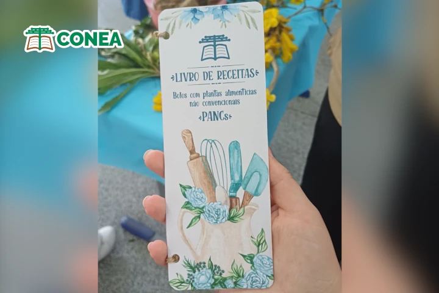
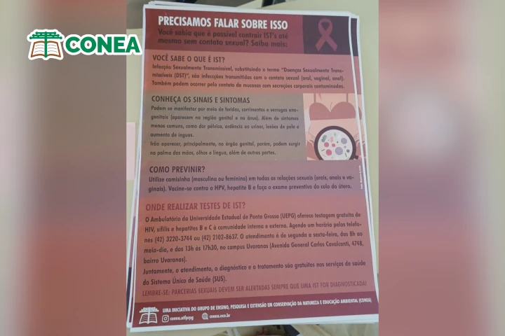

O grupo CONEA participou do "Princesa em Festa", evento de caráter sociorrecreativo e cultural promovido pela Secretaria Municipal de Cultura de Ponta Grossa, município do Paraná. Foram realizados dois presentes: o primeiro, "Promover uma oficina gratuita sobre receitas de bolos", consistiu em uma oficina de bolos feitos com plantas alimentícias não convencionais (PANCs), com duas receitas: bolo de ipê-amarelo e bolo de ora-pro-nóbis. A atividade foi realizada com mães de alunos e funcionárias da Escola Municipal Senador Flávio Carvalho Guimarães.

As participantes também receberam, de forma gratuita, um livreto de receitas com PANCs produzido pelo CONEA, que contém diferentes receitas, além das demonstradas durante a oficina:

O segundo presente, "Realizar uma campanha de conscientização sobre ISTs em ambiente acadêmico", consistiu na distribuição de pôsteres produzidos pelo CONEA, com informações sobre identificação, contaminação e acesso a testes, pelos banheiros da Universidade Tecnológica Federal do Paraná (UTFPR) campus Ponta Grossa. A ideia foi promover as informações de forma silenciosa, em um ambiente comumente frequentado, mas que permita a observação e leitura dos presentes.

